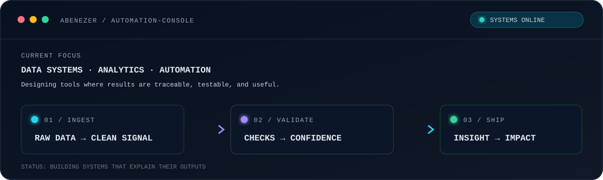

# Abenezer Bekele

### Information Systems · Data Analytics · AI for Business Operations

I build **reliable decision systems**: software that turns operational data into trusted metrics, clear diagnoses, and useful next actions.

<p align="center">
  
</p>

> **Focus:** data foundations → operational insight → governed AI-assisted action

## What I build

```text
OPERATIONS DATA        ANALYTICS LAYER               DECISION SUPPORT
events · records  ──▶  quality · metrics · models ──▶  alerts · forecasts · workflows
```

- **Analytics engineering** — clean, model, test, and document data so stakeholders can trust the metric.
- **Operations intelligence** — surface bottlenecks, risks, demand patterns, and decisions that affect real business workflows.
- **AI-enabled decision support** — use AI to accelerate analysis while keeping evidence, validation, and human judgment in the loop.
- **Information systems** — design the data models, rules, interfaces, and controls behind dependable business software.

## Selected systems

| System | Business value | Core capabilities |
| --- | --- | --- |
| [Course Registration & Degree Audit](https://github.com/Abenezer0101/GSU-pr0ject) | Applies business rules to student enrollment and tells users what they can take next. | SQLite, recursive prerequisite graphs, transaction-safe registration rules, degree-audit reporting, tests |
| [Customer Experience Dashboard](https://github.com/Abenezer0101/GSU-project) | Brings churn risk, customer feedback, and call-audio signals into a single operational view. | Streamlit, risk scoring, sentiment analysis, audio analysis, explainable visuals |
| [Bike-Share Data Quality Pipeline](https://github.com/Abenezer0101/bikeshare-data-cleaning) | Turns a messy trip export into analysis-ready data with a traceable audit trail. | pandas, data validation, quality rules, anomaly handling, visualization |
| [minidb](https://github.com/Abenezer0101/minidb) | Demonstrates the query and data-model foundations that analytical products depend on. | SQL parsing, query execution, joins, aggregation, differential testing against SQLite |

## Operating standard

```text
[✓] Metrics have definitions and provenance
[✓] Data quality failures are visible, not silently discarded
[✓] Models are evaluated against baselines
[✓] AI outputs are treated as evidence to verify—not answers to blindly trust
[✓] Every system is built around a real workflow and decision
```

## Current direction

I am concentrating future work on **business operations platforms** that combine:

1. event and transactional data pipelines,
2. trusted semantic metrics and data-quality controls,
3. forecasting, anomaly detection, and root-cause analysis, and
4. AI assistants that can recommend actions with traceable evidence and approval controls.

<sub>Older experiments remain available in the <a href="https://github.com/Abenezer0101/projects">full project archive</a>; this profile highlights the work most relevant to data analytics, AI, and business operations.</sub>
